# rn-route-audit

**A shared name for every screen, so designers, developers and QA stop
describing screens to each other.**

Maps every React Navigation route name to the screen that renders it, and
goes the other way — from a sentence someone read on screen back to the
route name.

Static analysis only: no simulator, no bundler, no running app, nothing to
install.



## The problem it solves

A designer and a developer look at the same screen and have no shared name
for it. The designer calls it "the amount step", the developer knows it as
`Send/StepFour`, analytics reports a third thing, and the bug ticket
describes it in prose. Every design review, QA report and handoff pays a
small tax for that, and the tax is invisible because nothing ever fails —
people just spend a minute working out which screen is being discussed.

The fix is cheap once the index exists: let each side look the screen up by
something they already have.

| Who | What they already have | What they get back |
|---|---|---|
| Designer | the words on the screen | the route name to write on the frame |
| Developer | the route name | the component file that renders it |
| QA | a route name from analytics | whether it is reachable at all, or gated behind a feature flag |

This tool builds that index from the source and keeps it current in CI. What
you do with it — put the route name on the Figma frame, sync it to a page the
designers already open, comment it on the pull request — is yours to choose;
see [What to do with the output](#what-to-do-with-the-output).

**What it is not:** it does not talk to Figma and it does not host anything.
It reads your source and emits JSON and CSV. Those are the parts that go
stale on their own; the rest is a five-line script against whatever tool your
team already uses.

## What the output looks like

One row per route, in `routes.json` and `routes.csv`. From a real run against
[BlueWallet](https://github.com/BlueWallet/BlueWallet):

```json
{
  "route": "About",
  "status": "mounted",
  "navigator": "navigation/DetailViewScreensStack.tsx",
  "component": "About",
  "file": "screen/settings/About.tsx",
  "style": "jsx-literal"
}
```

With `--i18n` pointed at your translations, each row also carries
`screen_title`, `sample_texts` and `text_keys` — the on-screen words that make
the designer-side lookup work.

CSV columns: `route, const, group, status, condition, screen_title,
sample_texts, component, file, navigator, text_keys, detail`.

## Requirements

Python 3.9 or newer (preinstalled on GitHub runners; no packages to install)
and a React Navigation project — v5, v6 or v7, including the v7 static API.

## Use as a GitHub Action

```yaml
- uses: actions/checkout@v4
- uses: estateangela/rn-route-audit@v1
  id: routes
  with:
    app: .
    i18n: locale/en.json
- run: echo "conditional screens: ${{ steps.routes.outputs.conditional }}"
- uses: actions/upload-artifact@v4
  with:
    name: route-audit
    path: ${{ steps.routes.outputs.csv }}
```

### Inputs

| Input | Default | Description |
|---|---|---|
| `app` | `.` | Path to the app repository (check it out first). |
| `src-dir` | `src` | Source root, relative to `app`. |
| `router-file` | `router/path.tsx` | File declaring `export const Foo = 'Bar'`, relative to `src-dir`. |
| `i18n` | — | Translation JSON paths relative to `app`, newline or comma separated. Needed for titles and lookup. |
| `alias` | `~/` | Import alias pointing at `src-dir` (e.g. `@/`). |
| `out-dir` | `rn-route-audit-out` | Where `routes.json` and `routes.csv` are written. |
| `fail-on-unmounted` | `false` | Fail the job when a route constant is never mounted. |
| `fail-on-unresolved` | `false` | Fail the job when a component cannot be traced to a file. |

### Outputs

`json`, `csv`, `total`, `mounted`, `conditional`, `unresolved`, `unmounted`.

## Comment on pull requests

The interesting question on a PR is not "what routes exist" but "which
screens did this change add, remove, rename, or hide behind a flag". Pass a
previous `routes.json` as `baseline-json` and the action reports the diff:

> ### Navigation changes
>
> **Renamed** — anything referring to the old name breaks (analytics, deep links, tests)
> - `Settings` → `Preferences`
>
> **Reachability changed**
> - `Main/Checkout` — mounted → **conditional** (`flags.newCheckout`)

Renames are reported as one change rather than a removal plus an addition,
because that is the case nothing else catches: the old name keeps appearing
in analytics dashboards, deep links and tests, and nothing fails loudly.

A ready-to-copy workflow is in [`examples/pr-comment.yml`](examples/pr-comment.yml).
It audits the base and head revisions, then posts — or edits — a single
comment, so a PR with ten pushes does not collect ten comments.

## What to do with the output

The action emits data and stops there; it does not own your integrations.
`routes.json` and `routes.csv` are both stable, so wiring them up is short:

| Goal | How |
|---|---|
| Keep a record per build | `actions/upload-artifact` with `${{ steps.routes.outputs.csv }}` |
| Fail a PR that leaves a dead route | `fail-on-unmounted: true` |
| Spreadsheet for designers or PMs | import `routes.csv` |
| Notion, Linear, Confluence… | read `routes.json` and call their API; key rows on `route`, and only write the fields you generate so hand-edited columns survive |
| Feed your own service | `routes.json` is a flat array of objects |

> **Think twice before publishing the output.** `screen_title` and
> `sample_texts` are your product's copy, including unreleased features. A
> static search site on GitHub Pages is public to everyone — keep the output
> in artifacts, a private wiki, or an access-controlled host instead.

## Use as a CLI

```bash
git clone https://github.com/estateangela/rn-route-audit
cd rn-route-audit

python3 -m rn_route_audit audit \
  --app ~/code/my-app --i18n locale/en.json

python3 -m rn_route_audit lookup \
  --app ~/code/my-app --i18n locale/en.json "Welcome back"
```

```
[exact]
  Main/Home
    key   home.greeting
    text  Welcome back
    file  src/container/HomeScreen.tsx  (mounted)
```

Lookup runs in three tiers — exact, substring, then normalized (whitespace,
punctuation and width stripped) — so interpolated copy such as
`You have {{count}} items left.` still matches what the user actually sees.

## What the statuses mean

| Status | Meaning |
|---|---|
| `mounted` | Declared, mounted unconditionally, component resolves to a file. Always reachable. |
| `conditional` | Mounted inside `{cond && (<Screen …>)}`. Unreachable while `cond` is false — `navigate()` throws. |
| `unresolved` | Mounted, but the component expression could not be traced (e.g. built by a factory call). |
| `unmounted` | Declared as a route constant, but nothing mounts it. Usually a leftover. |

## Validated against real projects

Route names are taken from the screen declarations themselves, because
requiring a route-constants file turned out to be a dead end. Measured by
cloning four projects and counting declaration styles:

| Project | `name={Const}` | `name="Literal"` | v7 static API | Routes found |
|---|--:|--:|--:|--:|
| [BlueWallet](https://github.com/BlueWallet/BlueWallet) | 0 | 114 | 0 | 92 |
| [Rocket.Chat.ReactNative](https://github.com/RocketChat/Rocket.Chat.ReactNative) | 0 | 0 | 147 | 87 |
| [react-navigation](https://github.com/react-navigation/react-navigation) (example app) | 7 | 1462 | 1057 | 71 |
| A private production app | 191 | 0 | 0 | 184 |

Inline literal names and the static API dominate; named constants appear in
one project out of four. An earlier version required the constants file and
produced an empty table -- or `FileNotFoundError` -- on three of these four.

In all four, every `file` in the output points at a file that exists.

## What your project needs to look like

Screens declared in any of these three ways are picked up. Nothing else is
required.

```tsx
<Stack.Screen name="Home" component={Home} />            // literal
<Stack.Screen name={HomePath} component={Home} />        // constant
createNativeStackNavigator({ screens: { Home } })        // v7 static API
```

Optional extras, each of which adds information when present:

* **A route-constants file** (`export const HomePath = 'Main/Home'`), so that
  `name={HomePath}` resolves to its string value. Line comments above a block
  become group labels. Without it, constants are reported under their
  identifier and flagged in `detail`.
* **i18n JSON** (nested or flat) plus `t('some.key')` calls, and
  `title={t('some.key')}` for the screen title. Required for reverse lookup.
* **`SomeRouterMap.set(Const, Component)`** registrations mounted as
  `component={SomeRouterMap.get(Const)}`.

Factory-built components (`component={makeScreen('x')}`) and other dynamic
expressions are reported as `unresolved` rather than guessed at. That means
"look at this yourself", not "broken".

## The cases this gets right

Every one of these broke a naive implementation first. They are pinned by
tests against a fixture app in `tests/fixtures/sample-app`.

0. **The route list does not come from a constants file.** See the table
   above: that assumption fails on most projects. Screen declarations are the
   source of truth.
1. **Namespaced tags.** `\w` does not match `.`, so matching `<(\w*Screen)`
   silently skips every `<Tab.Screen>` and those screens are reported as
   unmounted. Cost us 5 wrongly reported routes in production before a fixture
   test caught it.
2. **Arrow functions in attributes.** `options={({route}) => ...}` contains
   `>`, so matching `[^>]*` truncates the tag and loses `component`. The
   scanner tracks brace depth instead.
3. **Conditions must be proven to enclose the screen.** Looking back a fixed
   number of lines for the last `{cond && (` attributes an already-closed
   block to the next screen. This fails in *both* directions: flagged screens
   reported as always-on (so their flag-off path never gets tested), and
   unconditional screens reported as flagged.
4. **Dynamic registration.** `component={Map.get(Const)}` names no component,
   so `Map.set()` calls are parsed separately.
5. **Import specifiers that already carry an extension.** Appending another
   one produces `Screen.tsx.tsx`, which never exists.
6. **U+2028 in translation files.** It is a JavaScript line terminator and
   Python's `splitlines()` treats it as a newline, but `json.dumps` leaves it
   raw. Output escapes it, so embedding `routes.json` in a page is safe.

## Development

```bash
python3 -m unittest discover -s tests -t . -v     # 48 tests, no dependencies
```

CI runs the tests on Python 3.9 / 3.11 / 3.13 and then runs the action itself
against the fixture app, asserting the counts.

## Not included

* Route **params**. One route can render very different screens depending on
  params; this tool reports the route, not the parameter space.
* Runtime navigation. Only static `<Screen>` mounts are seen; a `navigate()`
  to a name that does not exist is not detected.
* Strings assembled at runtime. Only resolvable `t('key')` calls are collected.

## License

MIT
